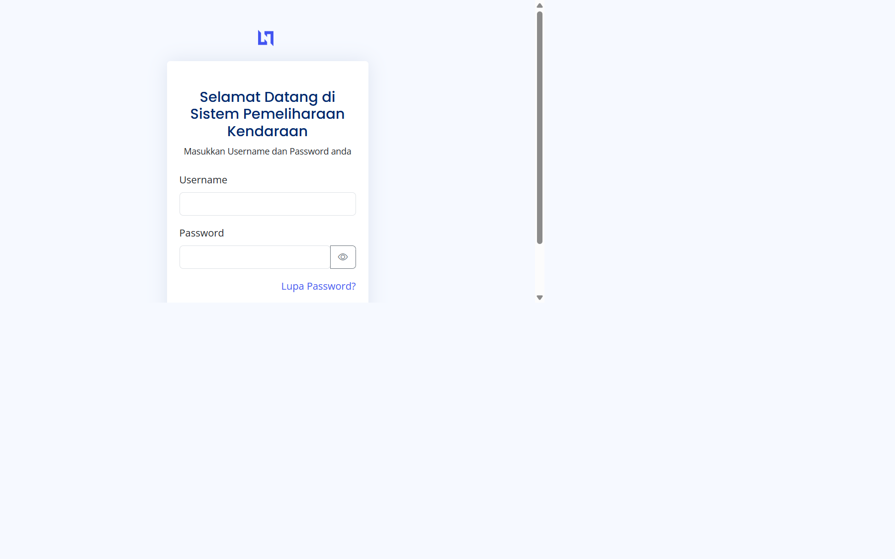
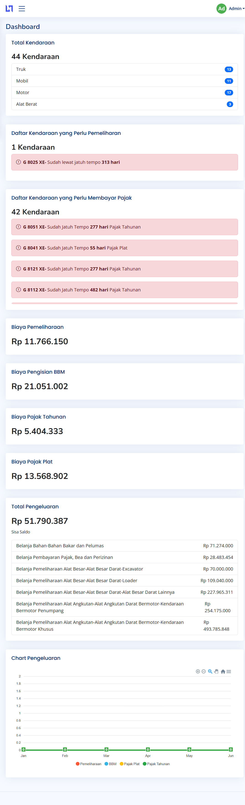

# SiPemDa

**SiPemDa** adalah aplikasi sistem informasi pemeliharaan kendaraan berbasis Laravel untuk membantu pencatatan dan pemantauan aset kendaraan, pemeliharaan, pengeluaran BBM, pajak, rekening, dan laporan keuangan.

## Fitur Utama

- Manajemen data pegawai dan hak akses
- Manajemen data kendaraan
- Pencatatan pemeliharaan kendaraan
- Pencatatan pengeluaran bahan bakar
- Pencatatan pajak tahunan dan pajak plat
- Manajemen rekening dan pengeluaran
- Dashboard ringkasan biaya serta jadwal pemeliharaan dan pajak
- Laporan pemeliharaan, BBM, pajak, dan pengeluaran

## Tampilan Aplikasi

### Halaman Login



### Dashboard



## Teknologi

- Laravel 11
- PHP 8.2+
- MySQL/MariaDB
- Tailwind CSS
- Vite
- PestPHP

## Instalasi

```bash
git clone https://github.com/zakyrama312/SiPemDa.git
cd SiPemDa
composer install
npm install
cp .env.example .env
php artisan key:generate
```

Sesuaikan koneksi database pada file `.env`, lalu jalankan migrasi dan seeder:

```bash
php artisan migrate
php artisan db:seed
```

Jalankan aplikasi:

```bash
npm run dev
php artisan serve
```

Buka aplikasi melalui `http://127.0.0.1:8000`.

## Lisensi

Proyek ini dikembangkan menggunakan Laravel, yang menggunakan lisensi MIT.
